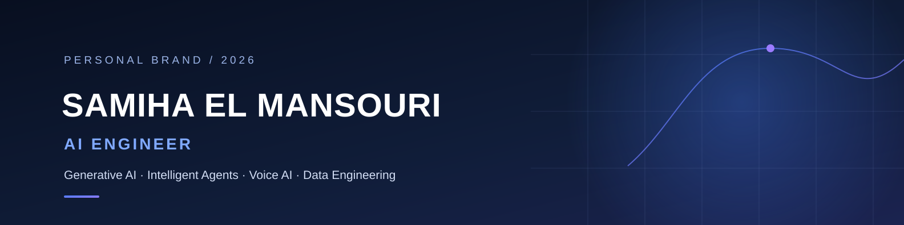
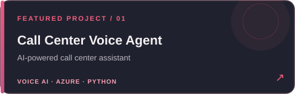
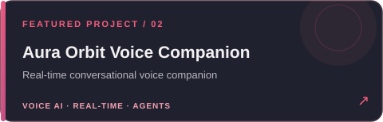
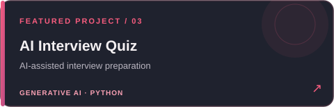
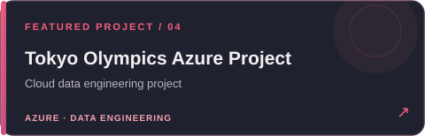

<!-- HERO BANNER -->

  

<!-- TYPING INTRO -->

  

<!-- SOCIAL ICONS — ROSE PINK -->

  
  &nbsp;&nbsp;&nbsp;
  
  &nbsp;&nbsp;&nbsp;
  
  &nbsp;&nbsp;&nbsp;
  
  &nbsp;&nbsp;&nbsp;
  
  &nbsp;&nbsp;&nbsp;
  

  
  

---

## 💗 About Me

I'm an **AI Engineer** focused on building practical applications with **Generative AI, intelligent agents, and conversational systems**.

My background in Data Engineering helps me connect AI capabilities with reliable data pipelines, backend services, and real product workflows.

- ✨ **GenAI:** RAG, LLM applications, embeddings, evaluation and prompt engineering
- 🤖 **AI Agents:** tool calling, orchestration, workflow automation and human handoff
- 🎙️ **Voice AI:** real-time conversational experiences and Azure AI Foundry / Voice Live
- 🧩 **Backend & Data:** Python, FastAPI, SQL, MongoDB, Redis and Azure

📍 Morocco · Open to AI Engineering opportunities in Morocco and remotely.
---

## 📘 My Top Open Source Projects

  
  

  
  

  

---

## 🛠️ Tech Stack

### 💻 Languages & Backend

  
  
  
  
  

### 🧠 Generative AI & Agents

  
  
  
  
  

### ☁️ Cloud & Data Engineering

  
  
  
  
  

---

## 📊 GitHub Activity

You can explore my latest repositories, contributions, and pinned projects directly on my
[GitHub profile](https://github.com/Samiha128).

---

  <strong>Thanks for stopping by! Let's build something meaningful with AI. 💗</strong>

